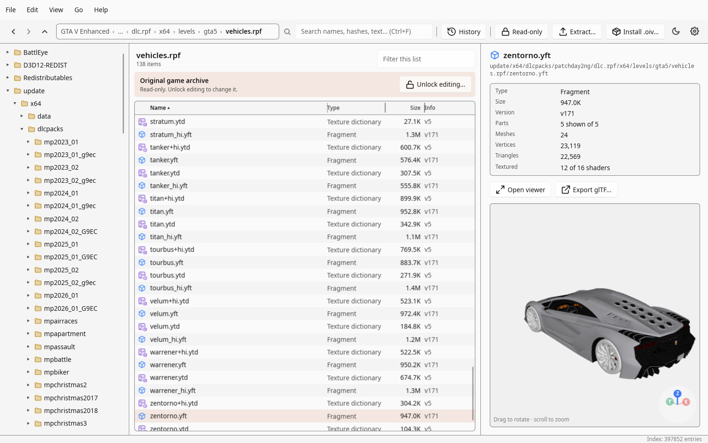
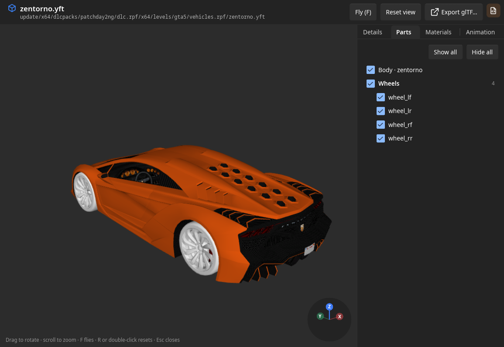
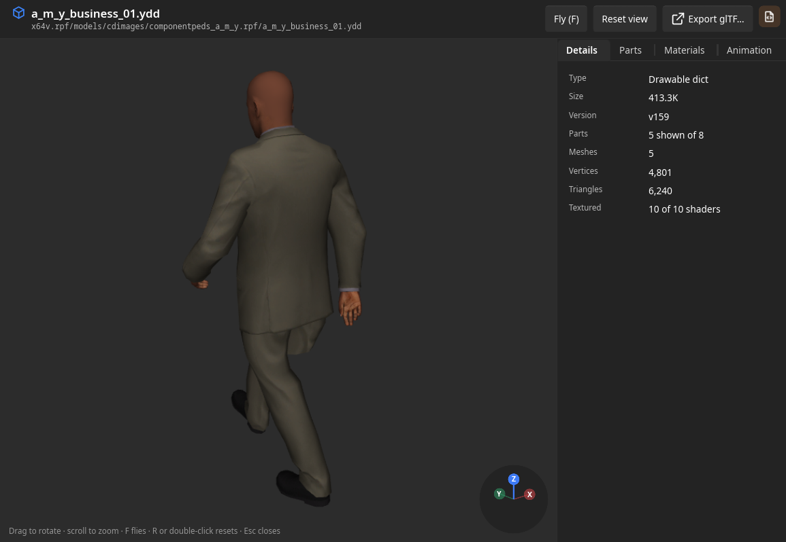
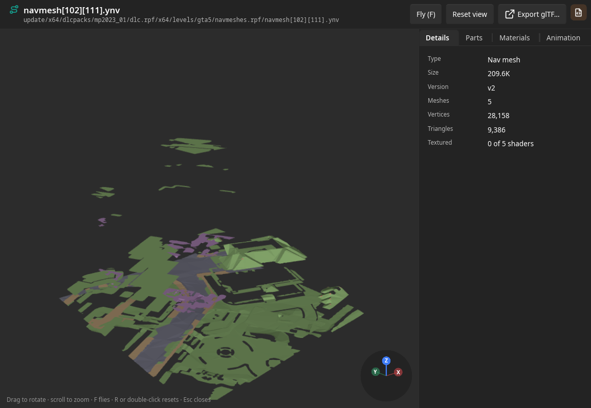
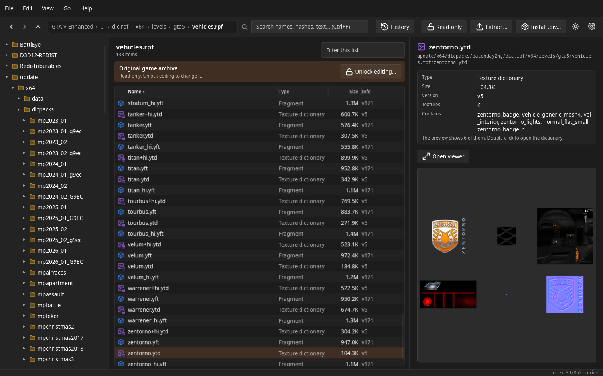

<div align="center">


# OpenRAGE

**The open-source successor to OpenIV — mod GTA V and Red Dead Redemption 2, and explore GTA VI, on Linux, Windows and macOS.**

### 🌴 New: GTA VI works!

**Browse and search its RPF9 archives, view the whole map in 3D, models, textures and animations, play sounds and videos.**<br>
[What works in GTA VI](https://two-play.github.io/openrage/gta-vi/) (read-only preview, with your own copy of the game)

Browse and search every archive, preview textures, models, sounds and animations, read metadata as XML,<br>
edit game text and install `.oiv` packages — compatible with OpenIV's `mods` folder, with undo.

**[Website](https://two-play.github.io/openrage/)** · **[Download](https://github.com/Two-Play/openrage/releases/latest)** · [Getting started](https://two-play.github.io/openrage/getting-started/) · [Documentation](https://two-play.github.io/openrage/guide/) · [Command line](https://two-play.github.io/openrage/cli/)

[](https://two-play.github.io/openrage/)
[](https://github.com/Two-Play/openrage/actions/workflows/ci.yml)
[](https://app.codacy.com/gh/Two-Play/openrage/dashboard?utm_source=gh&utm_medium=referral&utm_content=&utm_campaign=Badge_grade)
[](https://github.com/Two-Play/openrage/actions/workflows/dev-env.yml)
[](LICENSE)
[](rust-toolchain.toml)
[](#installation)
[](https://slint.dev)
[](https://wgpu.rs)

<picture>
  <source media="(prefers-color-scheme: dark)" srcset="docs/images/overview-dark.png">
  
</picture>

</div>

> [!NOTE]
> OpenRAGE is an independent community project. It is not affiliated with or endorsed by Rockstar Games or Take-Two Interactive, nor made by the OpenIV team. It contains **no game files and no encryption keys**: keys are taken from your own copy of the game at runtime.

## Highlights

OpenIV's last release was in January 2022. OpenRAGE picks up where it left off and stays compatible with it.

- **GTA VI explorer (preview):** browse and extract RPF9 archives, with folders, names and nested archives; see the whole map in 3D; preview models with their materials, collisions, navigation meshes, textures, metadata and text tables, play sounds and videos, search names and text, list clip dictionaries and play them on vehicles, weapons, props and parts of people.
- **Explorer and search:** archives, even nested ones, open like folders, as a list or as icons; names, hashes and full text of the whole game in milliseconds.
- **Every major format:** textures, models, audio, videos (Bink 1 and 2, with a player), animations, metadata as XML, collisions, paths, nav meshes, cutscenes, scripts, game text.
- **Coming from OpenIV?** Your `mods` folder and `.oiv` packages work as they are ([how to switch](https://two-play.github.io/openrage/getting-started/#coming-from-openiv)).
- **Mods, safely:** changes go to OpenIV's `mods` folder, never into your game files; every change and every `.oiv` package can be undone.
- **Models in:** replace props and vehicle bodies of GTA V Enhanced with your own OBJ models; doors and bonnets keep moving (preview).
- **ASI mods:** see and switch GTA V's ASI mods, and on Linux let Proton load the ASI loader with one click.
- **Tested on the whole game:** every format is checked against every file of GTA V ([details](https://two-play.github.io/openrage/#status)).

<table>
  <tr>
    <td width="50%"></td>
    <td width="50%"></td>
  </tr>
  <tr>
    <td width="50%"></td>
    <td width="50%"></td>
  </tr>
</table>

More screenshots and all features: **[two-play.github.io/openrage](https://two-play.github.io/openrage/)**

## Status

| Game | Archives | Formats |
|---|---|---|
| **GTA V** (Legacy & Enhanced) | ✅ read and edit (mods folder, with undo) | ✅ textures (also inside models) · models · audio · animations · metadata · text · collisions · paths · cutscenes · scripts · ASI mods (manager, Proton fix on Linux) · ◐ model import from OBJ with compressed textures and detail levels (Enhanced `.ydr` and vehicle bodies `.yft`, preview; explorer via the OBJ tools plugin) |
| **GTA VI** (Scarlett build, preview) | ◐ read-only RPF9: the table of contents is read with the game's own executable (one build); without it, a recovery view. Names of models and clips are known, of some other types not | ◐ models with skeletons · clip dictionaries (`.#cd`) · texture pools (`.ttpf`) and dictionaries (`.#td`; no volumes) · collisions (`.#bn`) · navigation meshes (`.#nv`) · maps in 3D · metadata, maps and text tables as XML (`.#mt`, `.#map`, `.#typ`, `.#ldbmt` and others) · audio · videos |
| **Red Dead Redemption 2** | ✅ read, with keys from your own game · ◐ edit (Lenny's Mod Loader `lml/replace` folder, with undo; nested archives rewritten; not yet tried in the game) | ◐ textures (replace same-shape) · models with moving parts and cloth · texts · metadata · audio · animations on fitting models · ped outfits (read-only) |
| **GTA IV** (Complete Edition) | ✅ read (IMG3, RPF2, RPF3), key from your own `GTAIV.exe` | ◐ textures · models · collisions · animations · text · scripts · maps in 3D · cutscenes (played with their cast, camera, subtitles and particle effects) · particle effect lists (`.wpfl`) · editing `.img`, `.rpf`, placement files, loose files and textures (`.wtd`, inside `.wdr`) (update folder, or the game files with originals kept) |

**Plugins** (API 0.3, preview): sandboxed WebAssembly plugins add file types, previews (text, tree, table, image, 3D model), tool windows of their own (Tools menu), export and batch actions with access to the game's models and textures, and changes to game files through the `mods` folder (with undo), for every game. ✅ explorer (file list, preview, context menu, Settings → Plugins) and command line (`openrage plugin`), four example plugins included (OBJ export and import, a number and hash converter among them) · plugin packages (`.orp`) with install/uninstall in the explorer and the CLI · models into game formats (`build-model`) · ✅ openFormats: OpenIV's text formats (`.odr`, `.oft`, `.odd`, `.otd` with `.mesh`, `.skel`, DDS) exported and imported back (preview). [Writing plugins](https://two-play.github.io/openrage/plugins/)

## Installation

Download the [latest release](https://github.com/Two-Play/openrage/releases/latest) for Linux (AppImage, Flatpak or `.tar.gz`), Windows (`.zip`) or macOS (Apple silicon, `.tar.gz`, preview) and start `openrage-gui`. On first start it finds your game and sets up the keys. Step by step: **[Getting started](https://two-play.github.io/openrage/getting-started/)**.

For the GTA VI preview, choose the folder containing `game_scarlett_master.exe` or RPF9 archives. With the supported executable beside the archives, OpenRAGE reads their tables of contents with the keys in it (the keys are not stored), so archives open at once. Names are matched to the hashes in the tables; files without a match are listed under `entries/`. Without the executable, or with another build, the explorer indexes the archives in the background and caches the results, which can take several minutes for large archives; recovered entries are then grouped by file type and offset, with model names recovered from their data where possible. Editing RPF9 archives is not supported.

The CLI also supports browsing, extraction and verification, for example `openrage --game <DIR> ls common.rpf` and `openrage --game <DIR> verify common.rpf` (or a folder or file inside it). Running `verify` without a path checks all RPF9 archives below the game folder. Verification decodes the entries with checksum, size and bounds checks and returns an error on a failed entry; in the recovery view, unread data is outside its coverage. Nested archives are checked when their path is given. `verify --animations <path>` reads the clip dictionaries below a path, nested archives included; other format-specific verification and `--rebuild` are not supported for GTA VI yet.

To build from source (Rust, pinned in `rust-toolchain.toml`; on Linux also the fontconfig, xkbcommon, Wayland and ALSA development packages):

```sh
git clone https://github.com/Two-Play/openrage.git && cd openrage
cargo build --release      # target/release/openrage-gui and target/release/openrage
```

## Documentation

- [Getting started](https://two-play.github.io/openrage/getting-started/): download, setting up your game, coming from OpenIV
- [Explorer and search](https://two-play.github.io/openrage/guide/): the window, keyboard, search, settings
- [Viewing files](https://two-play.github.io/openrage/viewers/): what each format shows and exports
- [Modding](https://two-play.github.io/openrage/modding/): edit mode, editing archives, undo, `.oiv` packages, the `mods` folder
- [GTA VI](https://two-play.github.io/openrage/gta-vi/), [GTA IV](https://two-play.github.io/openrage/gta-iv/) and [Red Dead Redemption 2](https://two-play.github.io/openrage/rdr2/): setup and what works per game
- [Command line](https://two-play.github.io/openrage/cli/): every `openrage` command
- [Writing plugins](https://two-play.github.io/openrage/plugins/): sandboxed WebAssembly plugins, SDK and API
- [Development](https://two-play.github.io/openrage/development/): building from source, build environment, releases, project layout

The website lives in [`site/`](site/) and is built from Markdown.

## Community

Questions, ideas, or want to show what you made? Join us on **Matrix**: **[#openRAGE:nope.chat](https://matrix.to/#/#openRAGE:nope.chat)**

New to Matrix? Open the link and pick a client, for example [Element](https://element.io/download); creating an account is free.

Found a bug or have a feature request? [Open an issue](https://github.com/Two-Play/openrage/issues/new/choose). Want to contribute code? See [CONTRIBUTING.md](CONTRIBUTING.md).

## License

GPL-3.0-only, except `crates/rage-tfit2` (the RDR2 archive cipher, ported from an AGPL-3.0 project), which is AGPL-3.0-only, and the plugin interface and SDK (`crates/openrage-plugins/wit`, `plugins/`), which are MIT OR Apache-2.0 so that plugins may use any licence. See [LICENSE](LICENSE) and [NOTICE.md](NOTICE.md) for third-party attributions, and [THIRD_PARTY_LICENSES.md](THIRD_PARTY_LICENSES.md) for the licenses of all third-party crates in the programs (generated from `Cargo.lock`, checked in CI). The same is in the app under **Help → About OpenRAGE**, via `openrage licenses` and on the [licenses page](https://two-play.github.io/openrage/licenses/).

Grand Theft Auto, Red Dead Redemption, RAGE and Rockstar Games are trademarks of Take-Two Interactive Software, Inc.
