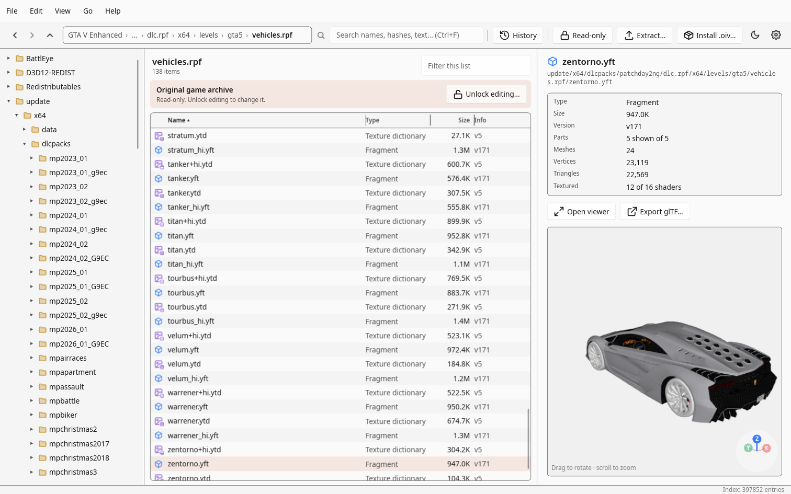
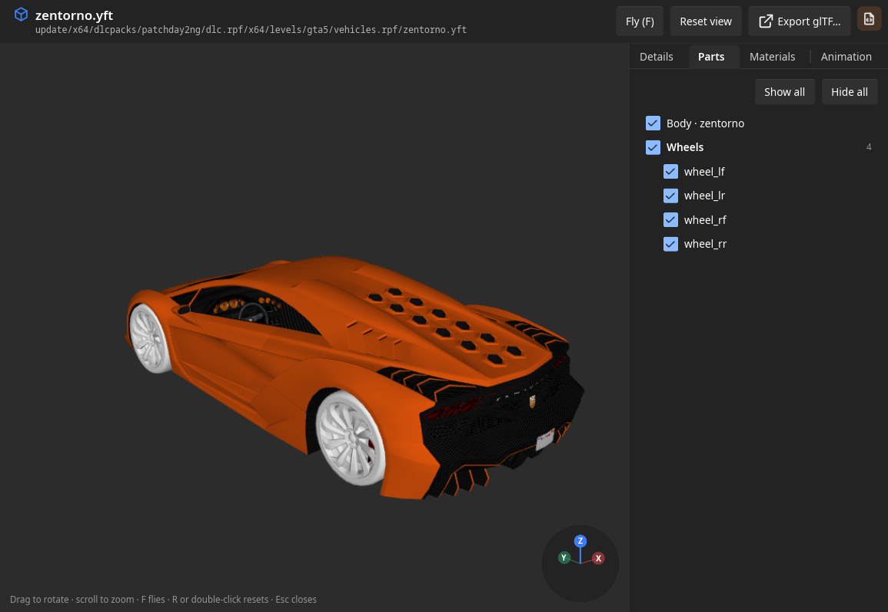
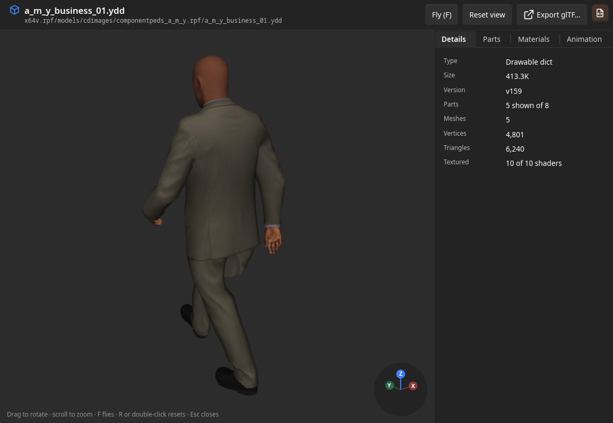
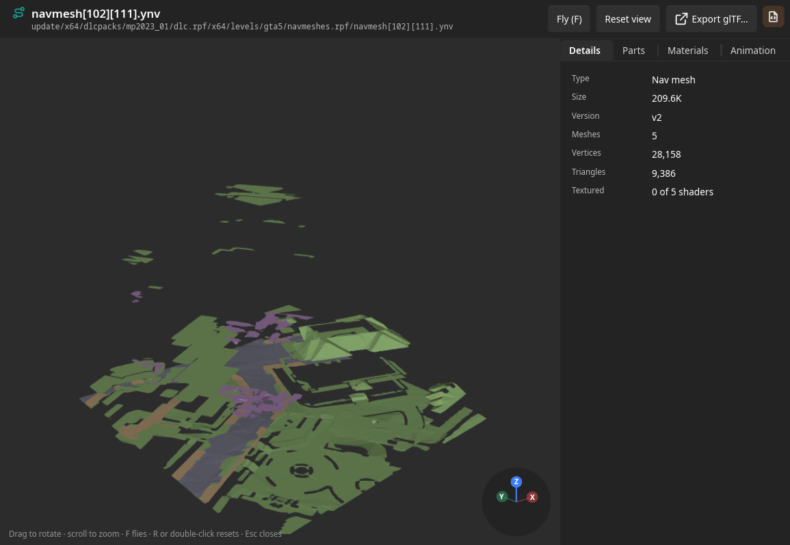
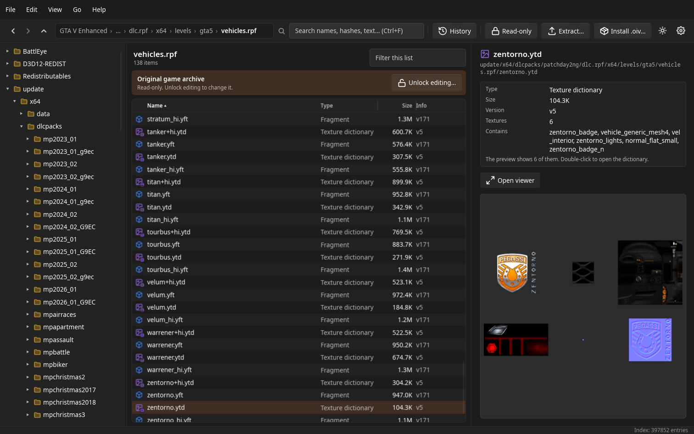

<div align="center">


# OpenRAGE

**The open-source successor to OpenIV — mod GTA V and explore Red Dead Redemption 2 on Linux and Windows.**

Browse and search every archive, preview textures, models, sounds and animations, read metadata as XML,<br>
edit game text and install `.oiv` packages — compatible with OpenIV's `mods` folder, with undo.

**[Website](https://two-play.github.io/openrage/)** · **[Download](https://github.com/Two-Play/openrage/releases/latest)** · [Getting started](https://two-play.github.io/openrage/getting-started/) · [User guide](https://two-play.github.io/openrage/guide/) · [Command line](https://two-play.github.io/openrage/cli/)

[](https://two-play.github.io/openrage/)
[](https://github.com/Two-Play/openrage/actions/workflows/ci.yml)
[](https://github.com/Two-Play/openrage/actions/workflows/dev-env.yml)
[](LICENSE)
[](rust-toolchain.toml)
[](#installation)
[](https://slint.dev)
[](https://wgpu.rs)

<picture>
  <source media="(prefers-color-scheme: dark)" srcset="docs/images/overview-dark.png">
  
</picture>

</div>

> [!NOTE]
> OpenRAGE is an independent community project. It is not affiliated with or endorsed by Rockstar Games or Take-Two Interactive, nor made by the OpenIV team. It contains **no game files and no encryption keys**: keys are taken from your own copy of the game at runtime.

## Highlights

OpenIV's last release was in January 2022. OpenRAGE picks up where it left off and stays compatible with it.

- **Explorer and search:** archives, even nested ones, open like folders; names, hashes and full text of the whole game in milliseconds.
- **Every major format:** textures, models, audio, animations, metadata as XML, collisions, paths, nav meshes, cutscenes, scripts, game text.
- **Coming from OpenIV?** Your `mods` folder and `.oiv` packages work as they are ([how to switch](https://two-play.github.io/openrage/getting-started/#coming-from-openiv)).
- **Mods, safely:** changes go to OpenIV's `mods` folder, never into your game files; every change and every `.oiv` package can be undone.
- **Ready for GTA VI:** support follows as fast as possible once GTA VI comes to PC.
- **Tested on the whole game:** every format is checked against every file of GTA V ([details](https://two-play.github.io/openrage/#status)).

<table>
  <tr>
    <td width="50%"></td>
    <td width="50%"></td>
  </tr>
  <tr>
    <td width="50%"></td>
    <td width="50%"></td>
  </tr>
</table>

More screenshots and all features: **[two-play.github.io/openrage](https://two-play.github.io/openrage/)**

## Status

| Game | Archives | Formats |
|---|---|---|
| **GTA V** (Legacy & Enhanced) | ✅ read and edit (mods folder, with undo) | ✅ textures · models · audio · animations · metadata · text · collisions · paths · cutscenes · scripts |
| **Red Dead Redemption 2** | ✅ read, with keys from your own game | ◐ textures · models · texts · metadata · audio · animations · ped outfits (read-only) |
| **GTA VI** | 🔜 next: as fast as possible once it comes to PC | – |
| **GTA IV** (Complete Edition) | ✅ read (IMG3, RPF2, RPF3), key from your own `GTAIV.exe` | ◐ textures · models (viewer, glTF export; read-only); text, maps next |

## Installation

Download the [latest release](https://github.com/Two-Play/openrage/releases/latest) for Linux (AppImage or `.tar.gz`) or Windows (`.zip`) and start `openrage-gui`. On first start it finds your game and sets up the keys. Step by step, including RDR2: **[Getting started](https://two-play.github.io/openrage/getting-started/)**.

To build from source (Rust, pinned in `rust-toolchain.toml`; on Linux also the fontconfig, xkbcommon, Wayland and ALSA development packages):

```sh
git clone https://github.com/Two-Play/openrage.git && cd openrage
cargo build --release      # target/release/openrage-gui and target/release/openrage
```

## Documentation

- [Getting started](https://two-play.github.io/openrage/getting-started/): download, setup of GTA V and RDR2, building
- [User guide](https://two-play.github.io/openrage/guide/): everything the GUI can do, format by format
- [Command line](https://two-play.github.io/openrage/cli/): every `openrage` command
- [Development](https://two-play.github.io/openrage/development/): build environment, releases, project layout

The website lives in [`site/`](site/) and is built from Markdown.

## License

GPL-3.0-only, except `crates/rage-tfit2` (the RDR2 archive cipher, ported from an AGPL-3.0 project), which is AGPL-3.0-only. See [LICENSE](LICENSE) and [NOTICE.md](NOTICE.md) for third-party attributions.

Grand Theft Auto, Red Dead Redemption, RAGE and Rockstar Games are trademarks of Take-Two Interactive Software, Inc. The screenshots show OpenRAGE displaying files from the author's own copy of the game.
