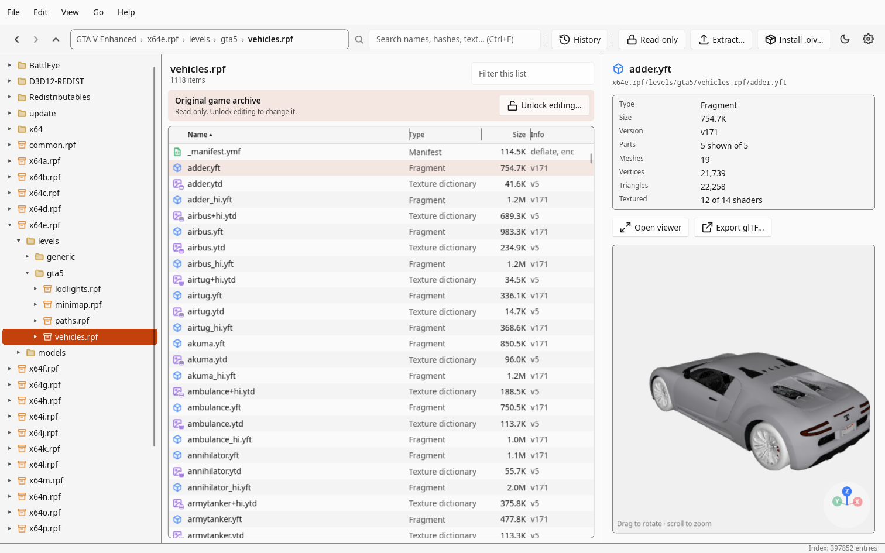
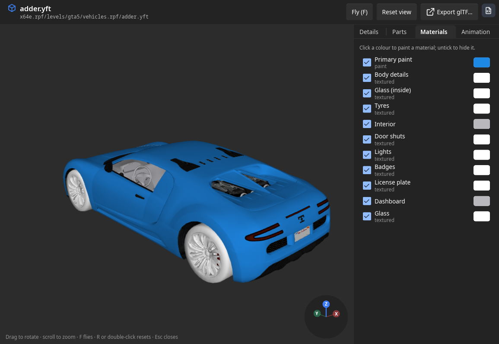
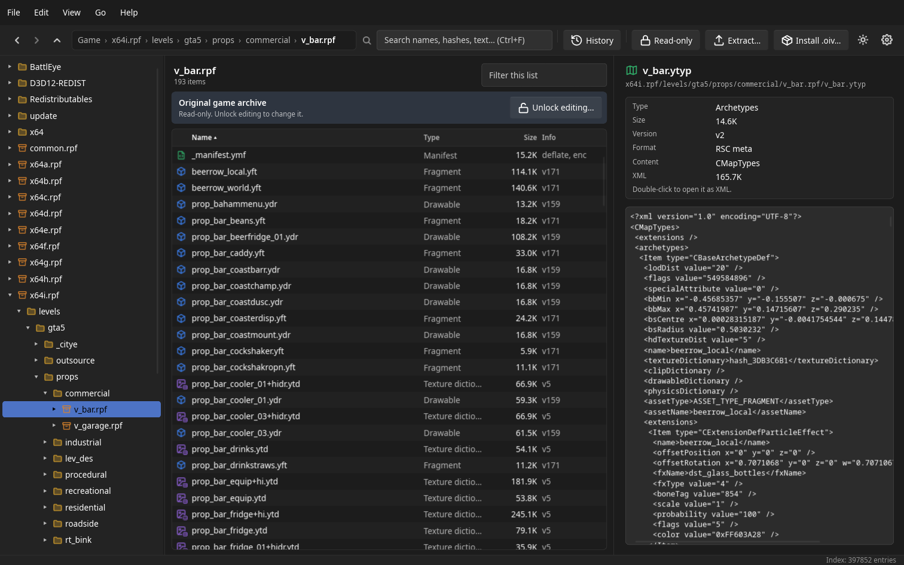
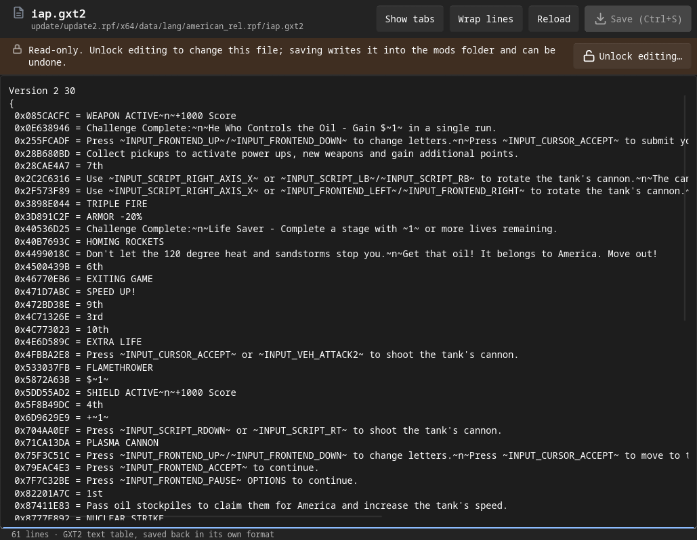

<div align="center">

# OpenRAGE

**An open-source explorer and modding toolkit for Rockstar's RAGE engine games — on Linux and Windows.**

Browse and search every archive, preview textures, models, sounds and animations, read metadata as XML,<br>
edit game text and install `.oiv` packages — compatible with OpenIV's `mods` folder, with undo.

[](https://github.com/Two-Play/openrage/actions/workflows/ci.yml)
[](https://github.com/Two-Play/openrage/actions/workflows/dev-env.yml)
[](LICENSE)
[](rust-toolchain.toml)
[](#installation)
[](https://slint.dev)
[](https://wgpu.rs)

<picture>
  <source media="(prefers-color-scheme: dark)" srcset="docs/images/explorer-dark.png">
  
</picture>

</div>

> [!NOTE]
> OpenRAGE is an independent community project. It is not affiliated with or endorsed by Rockstar Games or Take-Two Interactive. It contains **no game files and no encryption keys**: keys are taken from your own copy of the game at runtime.

## Contents

- [Highlights](#highlights)
- [Screenshots](#screenshots)
- [Status and roadmap](#status-and-roadmap)
- [Installation](#installation)
  - [Build from source](#build-from-source)
  - [Reproducible build environment](#reproducible-build-environment)
  - [Getting started (GTA V)](#getting-started-gta-v)
- [Using the GUI](#using-the-gui)
  - [Search](#search)
  - [Textures](#textures)
  - [Models](#models)
  - [Audio](#audio)
  - [Metadata (XML)](#metadata-xml)
  - [Text tables](#text-tables)
  - [Editing archives](#editing-archives)
  - [OpenIV packages (`.oiv`)](#openiv-packages-oiv)
  - [Mods folder (OpenIV compatible)](#mods-folder-openiv-compatible)
- [Command line](#command-line)
- [Project layout](#project-layout)
- [License](#license)

## Highlights

| | |
|---|---|
| 🗂️ **Explorer** | Archives — even nested ones — behave like folders. Breadcrumbs, format icons, context menus, keyboard navigation, light and dark mode. |
| 🔎 **Search everything** | Names, hashes (`0xB779A091` → `adder`) and full text of the whole game in milliseconds, from an index that updates itself. |
| 🖼️ **Textures** | All formats of GTA V Legacy and Enhanced (incl. BC7); DDS/PNG export identical to OpenIV; replace, add and remove. |
| 🚗 **Models** | Complete vehicles and peds in a GPU viewer: orbit or fly, show/hide parts, paint materials, export glTF for Blender. |
| 🔊 **Audio** | Plays every sound and radio track of the game, with waveform, seeking and WAV export. |
| 🏃 **Animations** | Clip dictionaries play on skinned models; fitting models are suggested from the bones a clip moves. |
| 📄 **Metadata** | `.ymap`, `.ytyp`, `.ymt`, `.ymf`, `.cut` and `.pso` as XML (RSC meta, PSO and RBF), compatible with CodeWalker. |
| ✨ **Particles** | `.ypt` effect dictionaries: effect, emitter and particle rule names, their textures and models. |
| 🧱 **Collisions** | `.ybn` collision meshes and shapes in 3D, coloured by material (concrete, metal, grass, …). |
| 🛣️ **Paths** | Road and footpath networks (`.ynd`), nav meshes (`.ynv`), vehicle and waypoint recordings (`.yvr`, `.ywr`) in 3D. |
| 🎬 **Cutscenes** | The cast of every cutscene; play any actor with its animation over the whole cutscene. |
| 📜 **Scripts** | Disassembles compiled game scripts (`.ysc`): functions, jumps, strings and native calls. |
| 🌐 **Game text** | Edit `.gxt2` text tables in OpenIV's `.oxt` form and save them back losslessly. |
| 🧩 **Mods, safely** | Changes go to OpenIV's `mods` folder, never into your game files; every change and every `.oiv` package can be undone. |

## Screenshots

<table>
  <tr>
    <td width="50%"></td>
    <td width="50%"></td>
  </tr>
  <tr>
    <td align="center"><b>Model viewer</b> — materials, paint, parts and animations</td>
    <td align="center"><b>Metadata as XML</b> — maps, archetypes, cutscenes, …</td>
  </tr>
  <tr>
    <td width="50%"></td>
    <td width="50%"></td>
  </tr>
  <tr>
    <td align="center"><b>Game text</b> — <code>.gxt2</code> as editable <code>.oxt</code></td>
    <td align="center"><b>Light mode</b> — follows the system or your choice</td>
  </tr>
</table>

## Status and roadmap

| Game | Archives | Formats |
|---|---|---|
| **GTA V** (Legacy & Enhanced) | ✅ RPF7 read, incl. nested archives; edit in place in the mods folder, with undo | ✅ textures · models · audio · animations · metadata · text tables |
| **GTA IV** | 🔜 planned (RPF3) | – |
| **Red Dead Redemption 2** | 🔜 planned (RPF8) | – |

Every format is checked against the complete game (GTA V Enhanced):

| Format | Files checked | Result |
|---|---:|---|
| Textures (`.ytd`) | 89,817 dictionaries, 341,701 textures | all decode; every dictionary rebuilds and reads back identically |
| Models (`.ydr`, `.yft`, `.ydd`) | 168,779 models | all load (583 million triangles) |
| Audio (`.awc`) | 7,758 containers, 252,742 sounds | all decode (279.8 hours) |
| Animations (`.ycd`) | 25,961 dictionaries, 332,771 clips | all evaluate |
| Metadata (`.ymap`, `.ytyp`, `.ymt`, `.ymf`, `.cut`, `.pso`) | 30,280 files | all convert to XML |
| Text tables (`.gxt2`, `.nametable`) | 19,858 files, 9.16 million strings | text → binary is byte-identical |
| Particles (`.ypt`) | 1,544 dictionaries, 12,987 effects | all read, incl. 1,694 textures and 1,223 models |
| Collisions (`.ybn`) | 14,692 files, 70,454 bounds | all read (101 million triangles, 4.7 million shapes) |
| Paths (`.ynd`, `.yvr`, `.ywr`) | 9,922 files, 232,982 nodes, 1.37 million recorded points | all read (521 hours of vehicle recordings) |
| Nav meshes (`.ynv`) | 10,567 files, 18.9 million polygons | all read |
| Scripts (`.ysc`) | 1,864 scripts, 383 million instructions | all disassemble, every jump lands on an instruction |
| Scaleform movies (`.gfx`), Bink videos (`.bik`) | 1,163 movies, 415 videos | all read (29,490 exported symbols, 207 minutes of video) |

**Roadmap**

- [x] Archive reading and CLI
- [x] GUI explorer with search and mods overlay
- [x] Textures (YTD)
- [x] Editing archives, `.oiv` packages, undo
- [x] Models (YDR/YFT/YDD → glTF, complete vehicles and peds, GPU viewer)
- [x] Audio (`.awc` playback, WAV export)
- [x] Animations (`.ycd` clips on skinned models)
- [x] Metadata as XML
- [x] Text tables (`.gxt2`, `.nametable`, `.ugc`)
- [x] Readable metadata view (structure tree, highlighted XML)
- [x] Particles (`.ypt`): effects, textures, models
- [x] Collisions (`.ybn`) in 3D
- [x] Paths (`.ynd`) and recordings (`.yvr`, `.ywr`) in 3D
- [x] Nav meshes (`.ynv`) in 3D
- [x] Scripts (`.ysc`) disassembler
- [x] Cutscenes: cast and actor animations over the whole cutscene
- [x] Scaleform movies (`.gfx`) and Bink videos (`.bik`): facts and names
- [ ] Whole cutscenes in one scene (all actors, camera)
- [ ] GTA IV
- [ ] Red Dead Redemption 2

## Installation

### Build from source

Requires a recent stable Rust toolchain (the exact version is pinned in `rust-toolchain.toml`; rustup picks it up automatically). On Linux the GUI also needs the development packages of fontconfig, xkbcommon, Wayland and ALSA (audio output):

```sh
# Fedora
sudo dnf install fontconfig-devel libxkbcommon-devel wayland-devel alsa-lib-devel
# Debian / Ubuntu
sudo apt install libfontconfig1-dev libxkbcommon-dev libwayland-dev libasound2-dev
```

```sh
cargo build --release
# binaries: target/release/openrage (CLI) and target/release/openrage-gui
```

### Reproducible build environment

For the system libraries there is a container image based on Fedora's toolbx image, `dev/Containerfile`:

```sh
dev/toolbox.sh            # build the image and create the "openrage" toolbox
toolbox enter openrage
cargo run --release -p openrage-gui
```

Inside the toolbox the GUI runs as usual (Wayland/X11, GPU, audio and your home folder, including the game, are shared). Without toolbx the image works with plain Podman or Docker:

```sh
cp rust-toolchain.toml dev/ && podman build -t localhost/openrage-dev -f dev/Containerfile dev
podman run --rm -v "$PWD":/src:Z -w /src localhost/openrage-dev cargo build --release
```

CI builds the image and OpenRAGE inside it whenever the environment or the dependencies change.

### Getting started (GTA V)

On first start the GUI shows a setup dialog that detects Steam installations and derives the keys. On the command line:

```sh
openrage --game "/path/to/Grand Theft Auto V" keys
```

OpenRAGE needs the archive keys from your own game installation. They are extracted once and cached at `~/.config/openrage/gtav.keys` (Linux) or `%APPDATA%\openrage\gtav.keys` (Windows).

> [!WARNING]
> Never share the key cache: it contains keys taken from your copy of the game.

- **GTA V Legacy** (`GTA5.exe`): all keys are found in the executable.
- **GTA V Enhanced** (`GTA5_Enhanced.exe`): the executable only contains the AES key; the NG keys are no longer stored in plain form. Pass a CodeWalker key blob you obtained yourself: `openrage keys --magic /path/to/magic.dat`. The blob is decrypted with the AES key from *your* executable and verified against `common.rpf` before it is cached.

The game directory is remembered after this step.

## Using the GUI

```sh
cargo run --release -p openrage-gui            # or: openrage-gui <virtual path>
```

The explorer shows a folder tree in which archives (including nested ones) behave like folders, a sortable file list with format icons (textures, models, maps, data, audio, scripts …), and a preview pane (text with a fixed-width font, hex dump for binaries and resource pages, resource version and page sizes). Extraction runs in the background and can be cancelled; its output matches OpenIV's.

- **Menus and context menus:** every action is in the menu bar (File, Edit, View, Go, Help) with its keyboard shortcut; right-click a file for the actions that apply to it (open, view, extract, export, replace, rename, delete, copy name/path).
- **Double-click** opens folders, archives and texture dictionaries; models and textures open in their own **viewer window** (also Ctrl+Enter) with a details panel. Several viewers can be open at once, e.g. to compare models.
- **Text editor:** double-click a text file (`.xml`, `.meta`, `.dat`, `.ini`, …) to open it in its own window — read-only until edit mode is unlocked; **Save** (Ctrl+S) writes it into the mods folder, can be undone, and keeps the file's encoding, line endings and tabs. Right-click → *Open with system app* opens a read-only copy in your default program.
- **Clip dictionaries** (`.ycd`): selecting one shows what it animates (peds, vehicles, objects) and a list of fitting models, ranked by the bones they share with the clips; click one — or double-click the file — to open it in the viewer with the animation playing.
- **Overviews:** a texture dictionary previews up to 16 of its textures at once; a drawable dictionary that is not a ped shows all its objects side by side. Files that contain other files (texture dictionaries, audio containers) carry a badge on their icon.
- **History** opens in its own window (View → *History in its own window* switches back to the list).
- **Address bar** with clickable breadcrumbs like a file manager; click the free space (or Ctrl+L) to type a path.
- The info panel shows metadata as a table (type, size, version, format, mip levels, meshes, triangles …).
- **Keyboard:** arrow keys, Page Up/Down, Home/End and Enter in the list; Backspace or Alt+Up goes up; Ctrl+L address, Ctrl+F search, F2 rename, Delete, Ctrl+Z undo. Help → Keyboard shortcuts (F1) lists them all.
- **Edit mode, like OpenIV:** OpenRAGE starts read-only. **Read-only → Editing** in the toolbar (or Edit → Unlock editing…) asks once per session; only then can archives, textures and packages be changed. The bar above the list says whether you are looking at an original game archive (changes are copied to `mods`) or the copy in `mods`.
- **Light and dark mode:** follows the system, or pick one under View → Theme (the sun/moon button switches quickly). The choice is remembered.

### Search

OpenRAGE keeps a search index of the whole game (built once in about 30 seconds, then updated incrementally — only archives that changed after a game update are re-read). The search field accepts:

- **names** — any part of a file or folder name, exact matches first;
- **hashes** — `0xB779A091`, `B779A091`, `3078201489` or `-1216765807` resolve to `adder` via a dictionary built from all names and identifiers in the game's data, and find files with that name hash and game text with that label hash;
- **text** — words in XML/META/DAT/UGC files, audio name tables and the game's GXT2 text tables (prefix matching, all words must occur). Game text is filtered to one language, by default your system language.

Typing `?query` into the address bar searches as well; Back returns to the results.

### Textures

Texture dictionaries (`.ytd`) open like folders: double-click one (or type its path) to list its textures with size, format and mip levels. Selecting a texture shows it in the preview; selecting a `.ytd` previews its first texture. **Extract…** writes DDS files exactly like OpenIV/CodeWalker (classic DXT/ATI FourCC headers, DX10 headers for BC7 and other modern formats); **Save PNG…** writes images. With nothing selected, the whole dictionary is exported into a folder named after it.

**Replace…**, **Add…** and **Remove** change the dictionary the OpenIV way: the archive is copied to the `mods` folder (or the copy already there is used) and rewritten there — your game files are never touched. Replacing a texture with a DDS of the same format, size and mip count only overwrites its pixels; anything else rebuilds the dictionary from its original structures with a fresh page layout. Archives are streamed while they are rewritten, so even multi-gigabyte archives need little memory.

Both layouts are supported: GTA V Legacy (resource version 13, Direct3D 9 formats) and GTA V Enhanced (version 5, DXGI formats such as BC7).

### Models

Selecting a model (`.ydr` drawable, `.yft` fragment such as a vehicle, `.ydd` drawable dictionary) shows it in 3D: drag to rotate, scroll to zoom. Models are shown **complete**: vehicles with their wheels on every wheel bone and their liveries, peds assembled from their components (head, hair, upper body, legs, accessories — the first variant of each), parts rigidly attached to bones in place. Textures are taken from the model itself, the `.ytd` next to it (`adder.ytd`, `adder+hi.ytd`) and, for vehicles, `vehshare.ytd`.

Double-click opens the model in a **viewer window** (rendered on the GPU via wgpu — Vulkan, DirectX 12, Metal or OpenGL — with a software fallback):

- **Orbit** (drag, wheel) or **Fly** (F): W A S D to move, Q/E down/up, Shift faster, drag to look around.
- **Parts:** grouped (body, wheels, ped components with their variants); show or hide groups or single parts.
- **Animation:** peds, vehicles (convertible roofs, doors, …) and props play clips from clip dictionaries (`.ycd`): search for a dictionary (e.g. `move_m@generic`, suggested for peds), pick a clip, play/pause, scrub, speed, loop. Skinned meshes, parts bound to bones and fragment parts (wheels) all follow the skeleton; skinning runs on the GPU.
- **Orientation compass:** the game's X/Y/Z axes in red/green/blue; click a letter to look along that axis.
- **Materials:** every shader with a readable name (primary paint, glass, tyres, interior, …); hide it or give it a colour — paint the car. Preview and glTF export follow.
- **Export glTF…** writes a binary glTF 2.0 file (`.glb`) with one node per shown part and the textures embedded, which Blender and other tools open directly (Z-up is converted to glTF's Y-up).

Not yet: vehicle mods and tuning parts, map placements in 3D (they can be read as XML).

### Audio

Audio containers (`.awc`) open like folders: effects and dialogue list their sounds, music and radio tracks show one multi-channel stream. Selecting a sound shows its waveform, length, sample rate and codec; **Play** (or double-click, or Space) plays it, clicking the waveform jumps. **Save WAV…** and **Extract…** write `.wav` files (16-bit PCM, like OpenIV).

Supported: PCM and IMA ADPCM (GTA V Legacy), MPEG audio (GTA V Enhanced), single sounds and block-based multi-channel streams, and Rockstar's audio encryption (whole files, sound data or stream blocks). The audio key comes from the key blob used during setup; key caches from older versions are upgraded automatically.

### Metadata (XML)

Map placements (`.ymap`), archetypes (`.ytyp`), `.ymt`, manifests (`.ymf`), cutscenes (`.cut`) and `.pso` files are shown as XML, formatted like CodeWalker's export: the preview shows the start; double-click (or **Show as XML**) opens a window with two views:

- **Structure:** the file as a tree — entities, archetypes, cutscene objects, … labelled with their type and name (`CEntityDef #3 · dt1_tc_ufocore`) — and the selected node's values as a table with readable names (`fTotalDuration` → *Total duration*), vectors as `x, y, z` and flags with their hex value. A filter finds names and values anywhere in the file.
- **XML:** the XML with syntax colors and line numbers; **Open as text** shows it in the text editor for copying.

**Export XML…** saves `name.ymap.xml`. All three binary encodings are read: RSC meta resources, PSO and RBF. Hashes are shown as names where the name is known: field and type names from a built-in list, model, texture and other asset names from the search index; unknown ones as `hash_XXXXXXXX`. Saving XML back into the game files will come later.

### Particles

Particle dictionaries (`.ypt`) list their effects (the names the game and scripts use, e.g. `bul_gravel_heli`), emitter and particle rules in the info panel. Their models — debris, shells, bottles, sparks — are shown side by side at the same size and open in the viewer; double-click the file to browse its textures like a texture dictionary (view, Save PNG, Extract; changing them is not supported yet).

### Collisions

Collision files (`.ybn`) open like models: the triangle meshes and the spheres, capsules, boxes and cylinders the game uses for physics, with each composite part in place. Surfaces are coloured by their material, whose names come from your game's `materials.dat` (CONCRETE, METAL_SOLID_MEDIUM, GRASS, …); in the viewer's Materials tab every material can be hidden or recoloured, and the collision exports to glTF like any model.

### Paths

Path node files (`.ynd`) show the road and footpath network of their map area: vehicle nodes in blue, pedestrian nodes in orange, with the links between them. Vehicle recordings (`.yvr`, the routes cars drive in missions) and waypoint recordings (`.ywr`, the routes people walk) show their route with start and end marked. Nav meshes (`.ynv`) show where peds can walk, coloured by kind: ground, pavement, road, water, interiors, train tracks and steep slopes. Each part can be hidden or recoloured in the viewer's Materials tab; a few of the game's recordings contain garbage points far outside the map, which are left out.

### Cutscenes

A cutscene (`.cut`) opens in the metadata window with a **Cutscene** tab: its length and its cast — people, vehicles, props, the camera, lights and audio. **Play animation** opens an actor's model in the viewer with its animation over the whole cutscene: the cutscene's sections (`name-0.ycd`, `name-1.ycd`, … 4 seconds each) are joined into one clip per actor. Playing all actors together in one scene, with the cutscene camera, will come later.

### Scripts

Compiled scripts (`.ysc`) show their name, code size, number of functions, natives, statics and their strings in the preview; double-click opens the disassembly: one instruction per line with its address, functions (with their names where the compiler kept them), labels at jump targets, the text next to every `STRING` and the hash of every native call. Native names appear once you load a list in the common NativeDB format (`natives.json`) with Help → **Load native names…** or `openrage natives <file>`; OpenRAGE ships none. Both opcode tables of GTA V (older builds, and newer ones with `STATIC_U24` and `IS_BIT_SET`) are recognised automatically by checking that every jump lands on an instruction.

### Scaleform movies and videos

Scaleform movies (`.gfx`, the game's menus and HUD) show their stage size, frame rate, the symbols they export and the texture images they load; **Export as SWF…** turns one into a Flash file for Flash tools such as JPEXS or Ruffle. Bink videos (`.bik`) show their size, frame rate, length and audio tracks, and — when FFmpeg is installed — a frame from the middle; double-click plays the video in your video player (VLC, mpv and other FFmpeg-based players play Bink).

### Text tables

Game text (`.gxt2`) opens in the text editor in OpenIV's `.oxt` form, one `0xHASH = text` line per string (label names are used where the search index knows them). Audio name tables (`.nametable`) show one name per line, and `.ugc` files open as the JSON they are. After **Unlock editing**, saving converts the text back to `.gxt2` or `.nametable` and writes it into the mods folder; the conversion is lossless for every text table of the game. **Export as text…** writes `.oxt` or `.txt`.

### Editing archives

Inside an archive, **Import…** (or dropping files onto the list, where the platform supports it), **Replace…**, **Rename…**, **New folder…** and **Delete** change the game the OpenIV way: the archive is copied to the `mods` folder once and then edited **in place** — new data is appended and only the table of contents is rewritten, so a change to a 2 GB archive takes milliseconds. Changes inside nested archives rebuild just that nested archive. Your game files are never touched.

Every change is recorded in `mods/.openrage/journal` and can be reverted with **Undo**, step by step, back to the original files (OpenIV has no undo).

### OpenIV packages (`.oiv`)

**Install .oiv…** (or `openrage-gui package.oiv`) shows the package — name, author, description — and exactly what installing it would change, before anything is written. Packages of format 2.x are supported: files added to or deleted from the game and from archives (also nested ones), new archives and DLC packs (`createIfNotExist`), text edits (`add`, `insert`, `replace`, `delete` with Equal/StartWith/Mask) and XML edits by XPath (`add` First/Last/Before/After, `replace`, `remove`) that keep the file's formatting. Changes go to the `mods` folder; loose files that are new (such as `.asi` plugins) go to the game folder, as loaders expect them there.

Every installed package can be **uninstalled** from **History** (or `openrage oiv uninstall`) — OpenIV cannot do that. Not supported yet: `<pso>` edits (such packages are refused with an explanation). `<defragmentation>` is skipped, as it only saves disk space.

### Mods folder (OpenIV compatible)

OpenRAGE understands the `mods` folder used by OpenIV.asi, where a file at `mods/<path>` replaces `<path>` in the game. It never changes that layout — it only shows what it means:

- **Mods** (toolbar toggle) shows the game the way it sees itself: replaced files are marked *mod*, files only in `mods` *new*, and folders containing mods *has mods*.
- Inside a modded archive every folder is compared with the original: entries are marked *added* (green), *changed* (orange) or *removed* (red, shown greyed out with a preview of the original).
- **Changes** lists every difference of all mods at once, across nested archives — including complete copies of game archives that contain no change at all and can simply be deleted.

## Command line

Paths are virtual: archives — including archives inside archives — behave like directories.

<details open>
<summary><b>Browsing, search and extraction</b></summary>

```sh
openrage ls                                    # game directory
openrage ls x64a.rpf/data
openrage ls -r update/update.rpf               # recursive, descends into nested archives
openrage info x64e.rpf/levels/gta5/vehicles.rpf
openrage find adder.yft                        # search all archives of the game
openrage extract common.rpf/data/cargens.meta -o out/
openrage extract x64a.rpf -o out/              # whole archive
openrage extract some.rpf -o out/ --expand-archives
openrage index                                 # build / update the search index
openrage search weapon_pistol                  # names + full text, shows matching lines
openrage search 0xB779A091                     # hash lookup
openrage search Pegassi --lang american        # game text in another language (or `all`)
```

</details>

<details>
<summary><b>Formats: textures, models, audio, animations, metadata, text</b></summary>

```sh
openrage textures x64e.rpf/levels/gta5/vehicles.rpf/adder.ytd                 # list textures
openrage textures …/adder.ytd --export out/ [--png]                            # DDS (default) or PNG
openrage textures …/blips.ytd --set radar_darts=new.dds --remove radar_taco_van   # written into mods/
openrage model …/vehicles.rpf/adder.yft                       # meshes, shaders, textures
openrage model …/adder.yft --export adder.glb                  # glTF with embedded textures
openrage model …/adder.yft --render adder.png [--yaw 1.2]      # software-rendered image
openrage audio x64/audio/sfx/RADIO_02_POP.rpf/alright.awc --export out/   # sounds → .wav
openrage clips x64c.rpf/anim/ingame/clip_move_.rpf/move_m@generic.ycd     # clips of a .ycd
openrage model …/a_m_y_hipster_01.ydd --render pose.png --anim "…/move_m@generic.ycd:walk@0.5"
openrage model …/csb_bogdan.ydd --render pose.png --anim "…/cuts_sil.rpf/sil_int.cut:csb_bogdan_dual@75"   # cutscene pose
openrage xml …/ufo.ymap [-o ufo.ymap.xml]      # metadata (.ymap/.ytyp/.ymt/.ymf/.cut/.pso) → XML
openrage xml …/ufo.ymap --tree                 # the readable structure, as in the GUI
openrage text …/american_rel.rpf/iap.gxt2 [-o iap.oxt]   # text table → OpenIV .oxt text
openrage particles …/ptfx.rpf/core.ypt         # effects, emitters, textures and models of a .ypt
openrage script …/script_rel.rpf/omega2.ysc [-o omega2.txt] [--strings]   # disassemble a script
openrage media …/scaleform_generic.rpf/hud.gfx [--swf hud.swf]   # Scaleform movie or Bink video facts
openrage natives natives.json                  # native names for script disassembly
```

</details>

<details>
<summary><b>Editing, packages and the mods folder</b></summary>

```sh
openrage put new.meta x64e.rpf/data/            # import into an archive (mods folder)
openrage mv x64e.rpf/a.xml x64e.rpf/b.xml       # rename / move inside an archive
openrage rm x64e.rpf/levels/gta5/paths.rpf       # remove a file or folder
openrage mkdir x64e.rpf/my_folder
openrage oiv info mod.oiv                      # what a package would change
openrage oiv install mod.oiv                   # install into the mods folder
openrage oiv list / oiv uninstall "Name 1.0"   # installed packages, uninstall
openrage history                               # changes made to the mods folder
openrage undo                                  # revert the newest change
openrage mods                                  # files in the OpenIV mods folder
openrage mods --changes [--deep]               # every added/removed/modified entry
```

</details>

<details>
<summary><b>Verifying against the whole game</b></summary>

```sh
openrage verify                                # decode every entry of every archive
openrage verify --textures [--rebuild]         # decode (and rebuild) every texture dictionary
openrage verify --models                       # parse every model of the game
openrage verify --audio                        # decode every sound of the game
openrage verify --animations                   # parse every clip dictionary, evaluate all frames
openrage verify --meta                         # convert every metadata file of the game
openrage verify --text                         # every .gxt2/.nametable → text → back, identical
openrage verify --particles                    # parse every particle dictionary
openrage verify --collisions                   # build the meshes of every collision file
openrage verify --paths                        # read every path node file, recording and nav mesh
openrage verify --scripts                      # disassemble every script and check every jump
openrage verify --media                        # read every Scaleform movie and Bink video
```

</details>

## Project layout

| Crate | Purpose |
|---|---|
| `rage-core` | shared primitives: hashing (joaat), positional I/O |
| `rage-crypto` | AES / NG ciphers, Rockstar's XXTEA, key discovery in the user's executable, key cache |
| `rage-rpf` | RPF7 reader and OpenIV-style writer, virtual file system over nested archives |
| `rage-index` | SQLite search index: names, hash dictionary, FTS5 full text, incremental updates |
| `rage-resource` | RSC7 resources: page layout, virtual pointers into system/graphics memory |
| `rage-formats` | game formats: textures, models, audio, animations, metadata (meta/PSO/RBF → XML), text tables |
| `rage-mods` | OpenIV `mods` folder: overlay resolution, folder comparison, change lists |
| `openrage-app` | settings, key setup, game detection, extraction, model and format logic shared by CLI and GUI |
| `openrage-cli` | the `openrage` command-line tool |
| `openrage-gui` | the Slint explorer (`openrage-gui`) |

The UI language is English; the GUI is built with Slint's translation support so further languages can be added.

## License

GPL-3.0-only. See [LICENSE](LICENSE) and [NOTICE.md](NOTICE.md) for third-party attributions.

Grand Theft Auto, Red Dead Redemption, RAGE and Rockstar Games are trademarks of Take-Two Interactive Software, Inc. The screenshots show OpenRAGE displaying files from the author's own copy of the game.
